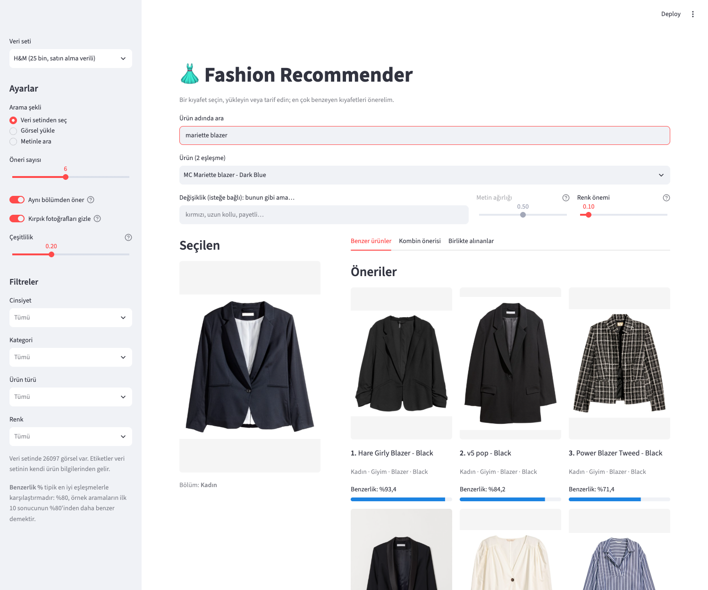
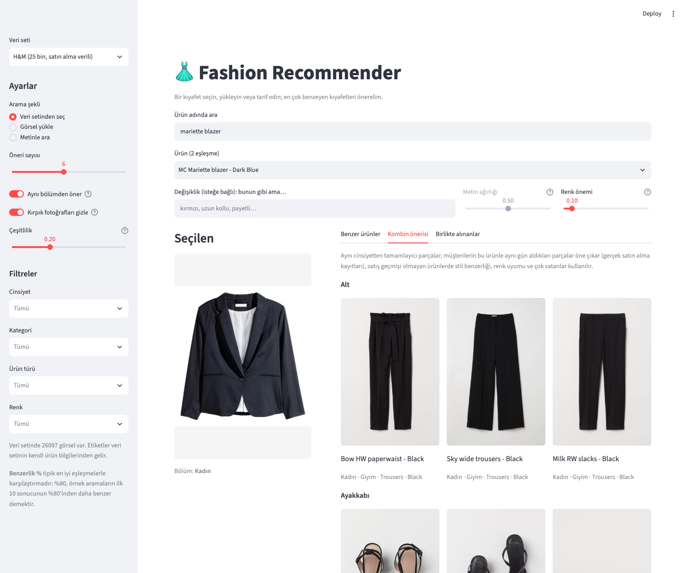
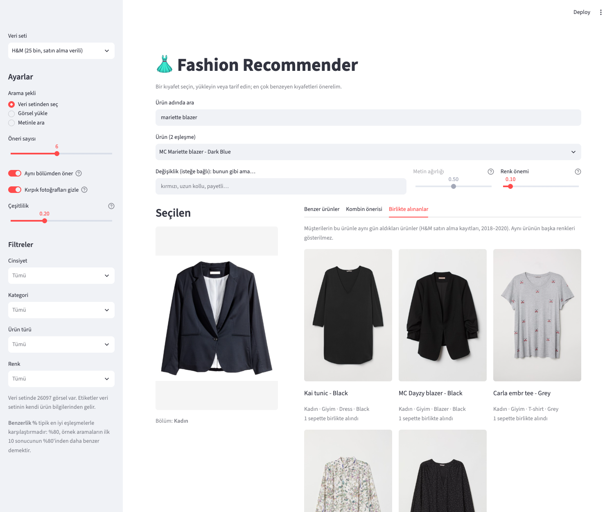
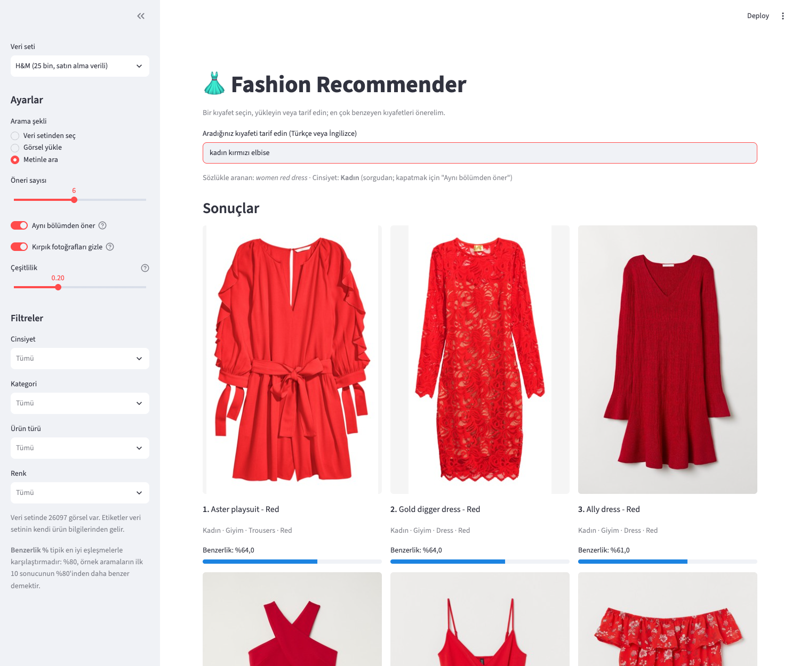

# 👗 Fashion Recommender

**Visual fashion search and recommendations with multilingual CLIP, real purchase data and honest evaluation.**
Pick a product, upload a photo or describe what you want (in Turkish or English) — get visually similar items, complete outfits and "frequently bought together" suggestions.

> **🇹🇷 Türkçe özet:** Görsel benzerliğe dayalı bir moda öneri sistemi. Bir ürün seçin, fotoğraf yükleyin ya da Türkçe/İngilizce tarif edin; benzer ürünler, kombin önerileri ve "birlikte alınanlar" gelir. Çok dilli CLIP, Türkçe moda sözlüğü, bölüm bazında (Kadın / Erkek / Çocuk / Aksesuar) ayarlar, H&M'in gerçek satın alma kayıtlarından öğrenilen kombinler ve BigQuery veri kaynağı içerir. Her karar gerçek etiketler ya da satın alma verisiyle ölçüldü. Ayrıntılı Türkçe belge: [README.tr.md](README.tr.md), geliştirme günlüğü: [PROJE.md](PROJE.md).

| Similar products | Outfit suggestions |
|---|---|
|  |  |
| **Frequently bought together** | **Text search in Turkish** |
|  |  |

## Features

- **Search three ways** — pick a catalogue item, upload a photo, or type a description ("kırmızı payetli elbise", "black lace dress").
- **"Like this, but red"** — combine an image with a text modifier.
- **Outfit suggestions** — complementary pieces (top → bottom + shoes + accessory), learned from real H&M purchases and backed by rules for new products.
- **Frequently bought together** — from 1M+ shopping baskets.
- **Other brands** — a "From other brands" tab shows the closest products from partner brands' product feeds (affiliate / Google Shopping), one row per brand, with price and a link to the store.
- **Search in stores** — the selected or uploaded item is described in Turkish from its labels ("kadın siyah elbise", editable) with links to the search pages of Zara, LCW, DeFacto, Koton, Mavi, H&M and Trendyol. Nothing is scraped; the store's own text search returns the results.
- **Segments** — Women / Men / Girls / Boys / Accessories, each with its own tuned settings; recommendations stay in the query's segment.
- **Turkish support** — a fashion glossary fixes CLIP's Turkish vocabulary gaps ("kemer" → belt).
- **Quality controls** — diversity re-ranking (no near-duplicate listings), hides products whose only photo is a cropped close-up, similarity shown as a calibrated percentage.
- **Data sources** — Fashion Product Images (44k), H&M (26k + purchases), your own **BigQuery** catalogue (read-only, cost-guarded), or brands' **product feeds**.
- **Ships as Docker** — one command to build, one to prepare a dataset, one to run.

## How it works

```
image / text ──► multilingual CLIP (xlm-roberta-base ViT-B/32) ──► 512-d embedding
                    ▲ Turkish glossary for queries
catalogue ──► embeddings (cached) ──► cosine similarity ──► segment & tag filters
                                                         ──► MMR diversity, cropped-photo filter
                                                         ──► calibrated "similarity %"
outfits ──► complementary slots × (co-purchase + popularity + style + colour/usage rules)
purchases ──► baskets (customer × day) ──► sparse co-purchase matrix
```

## Results — every decision was measured

| Question | Finding |
|---|---|
| Which image model? (44k products, labelled eval, precision@5) | **CLIP** beats VGG16 on article type (0.810 vs 0.755), colour (0.334 vs 0.266) and gender (0.874 vs 0.837) |
| Does a Turkish glossary help? (30 held-out Turkish queries, written *before* the glossary) | top-10 hit rate **0.68 → 0.83** |
| Does fine-tuning CLIP help? (linear adapter, held-out 20%) | only +1–2 points and hurts Turkish on validation → **not used** |
| Are hand-made outfit rules good? (H&M, train on old baskets, test on the last 3 months) | rules **0.026** < best-sellers 0.043 < co-purchase **0.087** (top-10 hit rate) |
| Same-segment recommendations? | gender precision for kids **0.85 → 1.00** |
| Diversity re-ranking (MMR) | queries with near-duplicate results **14% → 9%** for a 1-point precision cost |

### Lessons learned

- **Measure against real behaviour.** Outfit rules that looked convincing by eye predicted real purchases worse than simply recommending best-sellers; co-purchase data was 5× better for products with history.
- **The bottleneck isn't always the model.** Turkish search failed because CLIP didn't know words like "kemer" — a 200-term glossary beat model fine-tuning by a wide margin.
- **Evaluation code needs tests too.** Counting ties in the target's favour made popularity look better than it was; a typo in a label hid a working query.
- **Data has bugs.** ~23% of kids items were labelled as adult, some product photos showed a different product, and 3% of photos are cropped close-ups — each found by looking, then fixed with a measurable rule.

## Quick start

### Docker

```bash
docker compose build                                          # ~7 min, 4.4 GB image
docker compose run --rm app python scripts/setup_data.py hm   # download & prepare H&M (~1 h)
docker compose up                                             # http://localhost:8501
```

### Local (Python 3.11)

```bash
pip install -r requirements.txt
python scripts/setup_data.py hm          # or: products (44k), bq (your BigQuery table)
streamlit run app.py
```

Datasets are downloaded by each user from their original sources (see below); product images are not redistributed by the setup scripts. CLIP weights (~1.5 GB) download on first use. On Apple Silicon, embeddings are computed on the GPU (MPS).

### Your own catalogue from BigQuery

```bash
cp config/bigquery.example.toml config/bigquery.toml     # project, table, column mapping
python scripts/sync_bigquery.py --dry-run                 # shows queries + estimated scanned GB (free)
python scripts/setup_data.py bq
```

Read-only; table/column names are validated; a `--max-gb` guard stops expensive queries.

### Products from other brands (product feeds)

```bash
cp config/feeds.example.toml config/feeds.toml   # one [[feeds]] block per brand: feed URL or file, format
python scripts/sync_feeds.py --dry-run            # per brand: products kept / skipped, most common sections
python scripts/setup_data.py feed
```

Brands publish their catalogues as product feeds through affiliate networks (Admitad, Awin, Trendyol / Hepsiburada affiliate programmes…) or Google Merchant Center. Google Shopping XML and CSV are supported; categories and colours are mapped from Turkish or English keywords ("Kadın > Giyim > Elbise" → Women / Dress, "Lacivert" → Navy Blue), and non-fashion items are skipped. Once the `feed` dataset exists, every other dataset gets a **"From other brands"** tab for both catalogue items and uploaded photos; the `feed` dataset can also be opened on its own, with a brand filter. Only use feeds you have the right to use — the project does not scrape store websites.

## Datasets & licences

| Dataset | Source | Notes |
|---|---|---|
| H&M (26k products + purchases) | [H&M Personalized Fashion Recommendations](https://www.kaggle.com/competitions/h-and-m-personalized-fashion-recommendations) via Hugging Face mirrors | Competition data, non-commercial use; images © H&M |
| Fashion Product Images (44k) | [Kaggle](https://www.kaggle.com/datasets/paramaggarwal/fashion-product-images-small) (MIT), 384×512 HF copy | Images originate from Myntra |
| Women's fashion sample (93 images) | included in `data/women fashion/` | Demo fallback only; rights belong to their owners |

The code is MIT-licensed ([LICENSE](LICENSE)); dataset images remain the property of their respective owners. This is a learning project, not affiliated with any brand.

## Project structure

```
fashion_rec/          core package: embeddings, search, outfits, co-purchase, calibration, BigQuery …
app.py                Streamlit UI
scripts/              dataset setup / import, tuning, evaluation, BigQuery / product-feed sync
notebooks/            experiments and evaluations (model, pooling, colour, tags, diversity, outfits)
tests/                217 tests (no model / network needed — fake models and clients)
config/               bigquery.example.toml, feeds.example.toml
Dockerfile, docker-compose.yml
```

**Tech:** Python · PyTorch · open_clip · TensorFlow (VGG16) · NumPy / SciPy · Streamlit · Google BigQuery · Docker · pytest
