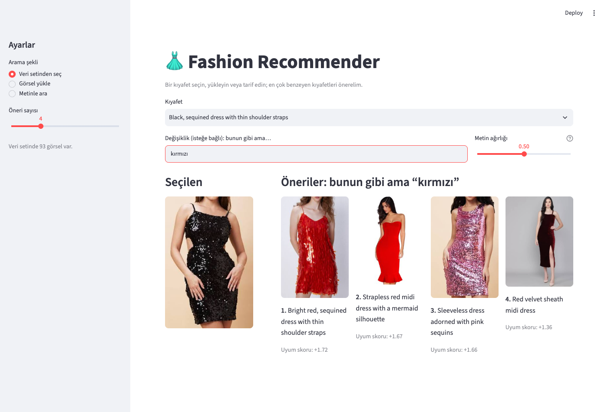

# 👗 Fashion Recommender

Görsel benzerliğine dayalı kıyafet öneri sistemi. Bir kıyafet görseli verildiğinde, veri setindeki görsel olarak en çok benzeyen kıyafetleri önerir. Kıyafeti Türkçe veya İngilizce tarif ederek de arama yapılabilir (ör. *kırmızı payetli elbise*). İkisi birleştirilebilir: bir kıyafet seçip "bunun gibi ama kırmızı" diye aranabilir. Sonuçlar otomatik renk ve tür etiketleriyle filtrelenebilir.

Üç şekilde kullanılabilir:

- **Python paketi** — `fashion_rec`
- **Komut satırı (CLI)** — `python -m fashion_rec ...`
- **Web arayüzü** — Streamlit




## Nasıl çalışır

1. `data/women fashion/` altındaki görseller listelenir (`.jpg`, `.jpeg`, `.png`, `.webp`).
2. ImageNet üzerinde önceden eğitilmiş **VGG16** ile her görselden bir özellik vektörü (25.088 boyut) çıkarılır ve L2 ile normalize edilir.
3. Vektörler `features.npz` dosyasına önbelleklenir. Görsel listesi değişince otomatik olarak yeniden hesaplanır.
4. Girdi görselinin vektörü tüm vektörlerle çarpılır (normalize vektörlerde nokta çarpımı = cosine benzerliği) ve en yüksek skorlu N görsel döner. Girdi görseli veri setindeyse sonuçlardan çıkarılır.

Veri setindeki bir görsel için vektör önbellekten alınır, model hiç yüklenmez. Model yalnızca veri setinde olmayan bir görsel geldiğinde açılır.

**Metinden arama** için çok dilli bir [CLIP](https://github.com/mlfoundations/open_clip) modeli (`xlm-roberta-base-ViT-B-32`, LAION-5B) kullanılır: görseller ve arama metni aynı vektör uzayına kodlanır, en yüksek cosine benzerliğine sahip görseller döner. Metin Türkçe veya İngilizce (ve diğer pek çok dilde) yazılabilir. CLIP vektörleri ayrı bir önbellekte (`clip_features.npz`) tutulur; önbellek modeli de kaydeder, model değişince otomatik yeniden hesaplanır.

**Görsel + metin birlikte arama** ("bunun gibi ama kırmızı") yine CLIP ile yapılır. Her görsel için hem sorgu görseline hem değişiklik metnine olan benzerlik hesaplanır. İki benzerlik farklı ölçeklerde olduğundan (görsel–görsel ≈0,5–0,9, görsel–metin ≈0,15–0,3) ikisi de z-skoruna çevrilir ve metin ağırlığıyla toplanır (0 = yalnız görsel, 1 = yalnız metin, varsayılan 0,5). 14 örneklik bir testte doğru kıyafet 12'sinde ilk 3'e girdi (yalnız görsel: 4, yalnız metin: 8).

**Renk önemi** (isteğe bağlı, varsayılan 0): VGG16 doku ve stile bakar, renge pek bakmaz. Renk önemi açılınca her görselin orta bölgesinden (arka planın etkisini azaltmak için) bir HSV renk histogramı çıkarılır ve VGG16 benzerliğiyle yine z-skoru + ağırlıkla birleştirilir. Ödünleşim vardır: 0,4'te renk tutarlılığı 0,17 → 0,26 artarken etnik/stil tutarlılığı 0,51 → 0,31 düşer. Bazı sorgularda belirgin iyileşme sağlar ("sparkling black dress" → siyah payetli elbiseler), arka planı geniş fotoğraflarda ise yanılabilir.

**Otomatik etiketler**: CLIP her görsele bir renk (siyah, beyaz, kırmızı, mavi, yeşil, pembe, sarı, mor, bej / kahverengi, gri / gümüş) ve bir tür (elbise, etnik, pantolonlu, etekli, ceket / üst) etiketi verir. Bunu, görselin vektörünü her etiketin tarif metniyle karşılaştırarak yapar; buna sıfır örnekli sınıflandırma denir. Dosya adlarıyla ölçülen doğruluk renkte %87, türde %85'tir. Etiketler `tags.npz` dosyasına önbelleklenir; etiket listesi veya model değişince yeniden hesaplanır.

**Benzerlik yüzdesi** (arayüz): ham skorlar (cosine ya da z-skoru toplamı) yönteme göre farklı aralıklardadır ve doğrudan yüzde değildir; CLIP'te metin–görsel benzerliği 0,30 çok iyi bir eşleşmedir. Arayüz bu yüzden skoru, aynı yöntemle yapılan örnek aramaların **ilk 10 sonucundan** oluşan bir referans dağılımla karşılaştırır (`fashion_rec/calibration.py`): %80, tipik en iyi eşleşmelerin %80'inden daha benzer demektir. Yalnızca en iyi eşleşmelerin kullanılması yüzdeyi katalog büyüklüğünden bağımsız kılar (tüm çiftlerle kıyaslansaydı 44 bin üründe her sonuç %99,9 görünürdü): iki veri setinde de tipik bir sorgunun 1. sonucu medyanda %72–78, 4. sonucu %45–53 alır. Anlamsız sorgular %0'a yakın kalır ("uçak" → %0). Komut satırı ham skoru gösterir.

Görselden görsele öneride VGG16 ile CLIP karşılaştırıldı ve belirgin bir kazanan çıkmadı. Metinden aramada çok dilli model, 20 Türkçe sorgunun 19'unda doğru kıyafeti ilk 3'e getirdi (OpenAI CLIP: 3/20). Ayrıntılar `PROJE.md` ve `notebooks/` altında.

## Kurulum

Python 3.11 gerekir. Örnek (conda):

```bash
conda create -n fashion-rec python=3.11
conda activate fashion-rec
pip install -r requirements.txt
```

İlk çalıştırmada VGG16 ağırlıkları (~60 MB) Keras tarafından, CLIP ağırlıkları (~1,5 GB) Hugging Face'ten otomatik indirilir. TensorFlow ve PyTorch birlikte kurulduğu için ortam ~3 GB yer kaplar.

## Kullanım

Tüm komutlar proje klasöründen çalıştırılır.

### Komut satırı

Özellikleri çıkarıp önbelleğe almak için (93 görsel için birkaç saniye sürer):

```bash
python -m fashion_rec index           # önbellek varsa onu kullanır
python -m fashion_rec index --force   # önbelleği yok sayıp yeniden hesaplar
python -m fashion_rec index --text    # metin araması (CLIP) indeksini de oluşturur
```

Bir görsele benzeyen kıyafetleri önermek için:

```bash
python -m fashion_rec recommend "data/women fashion/black floral saree.jpg" -n 5
python -m fashion_rec recommend "data/women fashion/sparkling black dress.jpg" -n 5 -c 0.5   # renk önemi 0.5
```

```
Girdi: black floral saree.jpg

 1. 0.455  Anarkali suit with fitted bodice with a high neckline.jpg
 2. 0.412  long, intricately designed dress with full sleeves.jpg
 3. 0.393  anarkali suit with intricate silver embellishments on the neckline, sleeves.jpg
 4. 0.379  anarkali suit with lavender in color with intricate white patterns throughout the fabric.jpg
 5. 0.376  black jumpsuit with a diagonal stripe of glittering material running across the body.jpg
```

Girdi görseli veri setinde olmak zorunda değil, herhangi bir görsel yolu verilebilir. Önbellek yoksa `recommend` onu önce kendisi oluşturur.

Metinle aramak için:

```bash
python -m fashion_rec search "kırmızı payetli elbise" -n 3
```

```
Sorgu: kırmızı payetli elbise

 1. 0.255  bright red, sequined dress with thin shoulder straps.jpg
 2. 0.218  sleeveless dress adorned with pink sequins.jpg
 3. 0.200  pink, knee-length dress that sparkles.jpg
```

CLIP skorları doğası gereği düşük ve birbirine yakındır (≈0,15–0,3); önemli olan sıralamadır. Her `search` çağrısı modeli yeniden yüklediği için ~10 sn sürer; arayüzde model bir kez yüklenir ve aramalar anında döner.

Bir görsele benzeyen ama bir yönüyle farklı kıyafetler için (`-w`: metin ağırlığı, 0–1):

```bash
python -m fashion_rec combine "data/women fashion/royal blue off-shoulder dress.jpg" "yeşil" -n 3
```

```
Girdi: royal blue off-shoulder dress.jpg + "yeşil" (metin ağırlığı 0.5)

 1. +2.05  flowing green off-shoulder dress.jpg
 2. +1.72  ark green, knee-length dress with short sleeves and a white, patterned neckline.jpg
 3. +1.62  light green, short dress with lace detailing around the waist and the edges of the sleeves and hem.jpg
```

Buradaki skorlar z-skorlarının ağırlıklı toplamıdır; 0–1 aralığında değildir, yalnızca sıralama içindir.

Otomatik etiketlerin dağılımını görmek için (`-v`: her görselin etiketleri):

```bash
python -m fashion_rec tags
```

```
Renk: mavi 17, siyah 16, kırmızı 10, beyaz 9, bej / kahverengi 9, gri / gümüş 9, pembe 8, yeşil 7, mor 4, sarı 4
Tür: elbise 65, etnik 16, pantolonlu 7, ceket / üst 3, etekli 2
```

### Web arayüzü

```bash
streamlit run app.py
```

Kenar çubuğundan arama şeklini (veri setinden seç / görsel yükle / metinle ara) ve öneri sayısını (1–12) seçin. Öneriler benzerlik skorlarıyla birlikte ızgara halinde gösterilir. Görsel modlarında isteğe bağlı **Değişiklik** kutusuna bir şey yazılırsa (ör. *kırmızı*, *uzun kollu*) görsel + metin birlikte aranır; yanındaki kaydırıcı metnin ağırlığını ayarlar. Değişiklik kutusu boşken **Renk önemi** kaydırıcısıyla rengi benzer kıyafetler öne çıkarılabilir. Kenar çubuğundaki **Filtreler** (renk, tür) her üç modda da sonuçları daraltır; bir grupta birden fazla etiket seçmek "veya", gruplar arası "ve" anlamına gelir. Her kartın altında o kıyafetin etiketleri görünür.

### Python'dan

```python
from fashion_rec.features import build_index
from fashion_rec.recommend import recommend

paths, features = build_index()
for path, score in recommend("benim_elbisem.jpg", paths, features, top_n=5):
    print(f"{score:.3f}  {path.name}")

from fashion_rec.color import build_color_index

_, colors = build_color_index()
results = recommend("benim_elbisem.jpg", paths, features, color_features=colors, color_weight=0.4)

from fashion_rec.text_search import build_text_index, load_clip_model, search

clip = load_clip_model()
paths, features = build_text_index(model=clip)
results = search("black lace dress", paths, features, top_n=5, model=clip)

from fashion_rec.text_search import combined_search

results = combined_search("benim_elbisem.jpg", "kırmızı", paths, features, top_n=5, text_weight=0.5, model=clip)
```

## Testler

```bash
python -m pytest
```

Testler sahte, hafif modeller (VGG16 ve CLIP yerine) ve düz renkli test görselleri kullanır. TensorFlow ve PyTorch yüklenmeden saniyenin altında çalışırlar.

## Proje yapısı

```
fashion-recommender/
├── fashion_rec/          # Python paketi
│   ├── __main__.py       # CLI giriş noktası
│   ├── config.py         # yollar, görsel boyutu, batch boyutu
│   ├── data.py           # görsel listeleme
│   ├── features.py       # model yükleme, özellik çıkarma, önbellek
│   ├── recommend.py      # benzerlik hesabı + öneri (isteğe bağlı renk ağırlığı)
│   ├── color.py          # renk histogramı + önbellek
│   ├── text_search.py    # çok dilli CLIP: metinden ve görsel + metin arama
│   ├── tags.py           # CLIP ile otomatik renk / tür etiketleri + filtre
│   ├── calibration.py    # ham skorları benzerlik yüzdesine çevirme
│   ├── catalog.py        # ürün adları ve veri setinin kendi etiketleri (metadata.csv)
│   ├── backbone.py       # görsel öneri modeli seçimi (VGG16 / CLIP)
│   ├── adapter.py        # CLIP üzerine eğitilmiş doğrusal adaptör (isteğe bağlı)
│   ├── glossary.py       # Türkçe moda terimleri sözlüğü (sorgu çevirisi)
│   ├── diversity.py      # çeşitlilik (MMR yeniden sıralama)
│   ├── outfit.py         # kombin önerisi
│   ├── copurchase.py     # birlikte alınanlar (satın alma kayıtları)
│   ├── segment_settings.py   # bölüm bazında ayarlar
│   └── segment_settings.json # scripts/tune_segments.py çıktısı
├── app.py                # Streamlit arayüzü
├── scripts/              # veri seti içe aktarma
├── data/women fashion/   # 93 kadın kıyafeti görseli
├── notebooks/            # model / havuzlama karşılaştırmaları
├── docs/                 # README görselleri
├── tests/                # pytest testleri
├── requirements.txt
└── PROJE.md              # yol haritası ve çalışma notları
```

Ayarlar (veri klasörü, önbellek yolları, görsel boyutu, batch boyutu, CLIP modeli) `fashion_rec/config.py` içindedir.

## Veri setleri

Veri seti `FASHION_DATASET` ortam değişkeniyle seçilir; belirtilmezse `products` indirilmişse o, değilse `women` kullanılır. Önbellekler `cache/<veri seti>/` altında ayrı tutulur.

| ad | içerik | görsel öneri modeli |
|---|---|---|
| `women` | 93 kadın kıyafeti, `data/women fashion/`, git'te. Dosya adları kıyafetin açıklamasıdır (ör. `black floral saree.jpg`). | VGG16 |
| `products` (indirilmişse varsayılan) | [Fashion Product Images](https://www.kaggle.com/datasets/paramaggarwal/fashion-product-images-small): 44.072 ürün, 384×512 görseller, `data/products/`, git dışında. Cinsiyet, ana kategori, ürün türü ve renk etiketli. | CLIP |
| `hm` | [H&M](https://www.kaggle.com/competitions/h-and-m-personalized-fashion-recommendations/data) ürünlerinden ~25 bin ürünlük dengeli alt küme, `data/hm/`, git dışında. Temiz stüdyo çekimleri; cinsiyet, ürün grubu, ürün türü ve renk etiketli (kullanım etiketi yok: Spor dışı her şey "günlük"). | CLIP |

```bash
streamlit run app.py                                   # products indirilmişse onu açar
FASHION_DATASET=women streamlit run app.py             # 93 görsellik kadın veri seti
python -m fashion_rec search "kız çocuk elbisesi"
```

**`hm` kurulumu** (~1 GB disk, öğrenme amaçlı; haklar H&M'e ait, Kaggle yarışma kuralları gereği ticari olmayan kullanım):

```bash
python scripts/import_hm.py --limit 25000                # etiketler + görseller (~1 saat)
FASHION_DATASET=hm python -m fashion_rec index           # CLIP vektörleri
FASHION_DATASET=hm python scripts/tune_segments.py       # bölüm ayarları
FASHION_DATASET=hm streamlit run app.py
```

Etiketler Hugging Face'teki `Qdrant/hm_ecommerce_products` kopyasından (oradaki görsel bağlantıları artık çalışmıyor), görseller `microsoft/hnm-search-data` deposundan alınır; bölümlere dengeli dağıtılır, aynı ürünün en fazla 2 renk çeşidi seçilir ve görseller 512 piksel yüksekliğe küçültülür.

**`products` kurulumu** (~4 GB disk): `scripts/import_products.py` dosyasının başındaki komutla Hugging Face'teki 384×512 kopyayı (`benitomartin/fashion-product-images-small-384x512`, 5 parquet dosyası, 2 GB) `data/products/raw/` altına indirin, sonra:

```bash
python scripts/import_products.py                       # görseller + metadata.csv
FASHION_DATASET=products python -m fashion_rec index    # CLIP vektörleri (Apple GPU ile ~4 dk)
```

Bu veri setinde arayüzdeki filtreler CLIP tahminleri yerine ürünlerin kendi etiketlerinden gelir: **Cinsiyet** (Erkek / Kadın / Erkek Çocuk / Kız Çocuk / Unisex), **Kategori** (Giyim / Aksesuar / Ayakkabı / Kişisel Bakım…), **Ürün türü** ve **Renk**. Ürün seçici, açılır liste yerine ad aramasıyla çalışır.

**Bölümler**: ürünler Kadın / Erkek / Kız Çocuk / Erkek Çocuk / Aksesuar bölümlerine ayrılır (aksesuarlar cinsiyetten bağımsız; birkaç yüz unisex ürün ayrı). Arayüzde **Aynı bölümden öner** (varsayılan açık) önerileri seçilen ürünün bölümüyle sınırlar; yüklenen görselin bölümü en yakın 20 komşunun çoğunluğundan tahmin edilir. **Renk önemi** her bölüm için ölçülmüş değerle açılır (`scripts/tune_segments.py` → `fashion_rec/segment_settings.json`; hedef: ürün türü ve renk isabetinin ortalaması, sorguların yarısında seçilip diğer yarısında ölçülür):

| bölüm | ürün | cinsiyet isabeti: tüm katalog → aynı bölüm | seçilen renk önemi | renk isabeti (0 → seçilen) | tür isabeti (0 → seçilen) |
|---|---|---|---|---|---|
| Kadın | 12.852 | 0,944 → 1,000 | 0,2 | 0,360 → 0,446 | 0,764 → 0,706 |
| Erkek | 17.492 | 0,964 → 1,000 | 0,3 | 0,461 → 0,597 | 0,922 → 0,892 |
| Kız Çocuk | 807 | 0,855 → 1,000 | 0,2 | 0,460 → 0,565 | 0,764 → 0,733 |
| Erkek Çocuk | 1.030 | 0,845 → 1,000 | 0,4 | 0,450 → 0,632 | 0,921 → 0,864 |
| Aksesuar | 11.244 | 0,878 → 0,876 | 0,5 | 0,463 → 0,562 | 0,940 → 0,913 |

Veri setinde adında "girl" geçen 185, "boy" geçen 210 ürün yetişkin olarak etiketlidir (ör. "Doodle Girl Little Princess Pink Tops" → Women); bunlar adlarına göre çocuk bölümüne alınır (`catalog.corrected_gender`). Benzerlik yüzdesi de bölüm içindeki tipik eşleşmelerle hesaplanır.

**Çeşitlilik** (kenar çubuğu, varsayılan 0,2): neredeyse aynı ürünlerin (aynı ürünün başka ilanı, aynı modelin renkleri) önerileri doldurmasını önler. Bölüm içi ilk 5 öneride sorguların %28'inde aynı adlı ürün tekrarı vardı; ama aynı adlı ürünlerin çoğu farklıdır (görsel benzerlik medyanı 0,85, yalnız %6'sı neredeyse aynı fotoğraf), bu yüzden ada göre eleme yerine görsel MMR yeniden sıralaması kullanılır (`fashion_rec/diversity.py`): aday, sorguya benzerliğiyle puan kazanır, seçilmiş önerilere benzerliğiyle (ve sorgunun neredeyse kopyasıysa) puan kaybeder. `notebooks/compare_diversity.py` (1.000 sorgu):

| çeşitlilik | tür isabeti | öneriler arası benzerlik | neredeyse kopya içeren sorgu |
|---|---|---|---|
| 0 | 0,876 | 0,844 | %14 |
| **0,2** | 0,866 | 0,826 | %9 |
| 0,4 | 0,838 | 0,788 | %8 |
| 0,6 | 0,772 | 0,728 | %0 |

**Kombin önerisi** (görsel modlarında "Kombin önerisi" sekmesi, `fashion_rec/outfit.py`): seçilen ürünü tamamlayan parçalar (gömleğe alt + ayakkabı + aksesuar, elbiseye ayakkabı + aksesuar…). Veri setinde "birlikte giyilir" bilgisi olmadığından kurallara dayalıdır:
- rol alt kategoriden çıkar (üst / alt / tek parça / ayakkabı / aksesuar), yuvalar role göre seçilir,
- adaylar aynı cinsiyetten (veya unisex) ve uyumlu kullanımdandır (resmi ↔ resmi / yarı resmi, spor ↔ spor / günlük, etnik ↔ etnik / günlük),
- sıralama: CLIP stil benzerliği + kullanım birebir eşleşmesi + renk uyumu (nötr renkler ve kot her şeyle uyar, iki farklı canlı renk cezalı) + mevsim,
- etiket hatalarına karşı iki kontrol: adı başka rolü söyleyen ürünler ("… White Shirts" adlı terlik) ve görseli yuvanın rolüne benzemeyen ürünler (CLIP; "… Wallet" görselinde gömlek) aday olmaz; neredeyse aynı görseller bir yuvada tekrarlanmaz,
- yüklenen görselde ürün türü, cinsiyet ve kullanım en yakın 20 komşudan tahmin edilir.

Vekil ölçütler (`notebooks/outfit_examples.py`, 500 sorgu; sezgisel bu kuralları kullandığı için yalnızca kuralların işlediğini gösterir): kullanım birebir 0,84 (rastgele) / 0,89 (yalnız CLIP) / **0,97**; renk uyumu 0,88 / 0,81 / **0,98**. Asıl değerlendirme gözle: `notebooks/outfit_examples/examples.png`. Sınırlama: desen uyumuna bakmaz (ekose gömleğe ekose şort önerebilir).

**Birlikte alınanlar ve satın alma verisiyle kombin (H&M)**: H&M'in 31,8 milyon satın alma kaydından (2018–2020) katalogdaki ürünleri içeren 5,6 milyon satır kullanılır (`scripts/build_copurchase.py`). Sepet = aynı müşterinin aynı gün aldıkları; ~1 milyon sepetten 1,6 milyon ürün çifti çıkar. Arayüzde H&M veri setinde üçüncü sekme **Birlikte alınanlar** (aynı ürünün başka renkleri hariç) ve kombin önerisinde birlikte alınma sinyali (`fashion_rec/copurchase.py`).

Kombin önerisinin ilk gerçek ölçümü (`notebooks/evaluate_copurchase.py`): 2020-06-22 öncesiyle öğrenilip sonraki 3 ayın sepetlerinde test edildi; ölçüt, müşterinin sorgu ürünüyle aynı gün aldığı tamamlayıcı parçanın (ör. üstle alınan pantolon) yuvadaki ~2.200 aday arasında ilk 10'a girme oranı:

| yöntem | ilk 10 (tümü) | geçmişi olan ürünler | yeni ürünler |
|---|---|---|---|
| rastgele | 0,004 | 0,004 | 0,012 |
| kurallar (önceki kombin) | 0,026 | 0,022 | 0,035 |
| çok satanlar | 0,043 | 0,046 | 0,035 |
| birlikte alınma | 0,087 | 0,109 | — |
| **kurallar + birlikte alınma + çok satanlar** | **0,088** | **0,110** | 0,035 |

Kurallar tek başına çok satanlardan bile zayıf çıktı; birlikte alınma, geçmişi olan ürünlerde kurallardan ~5 kat iyi. Yeni ürünlerde (satış geçmişi yok) birlikte alınma bilgisi olmadığından kurallar devreye girer (hedefin medyan sırası kurallarda 444, çok satanlarda 1.135). Sınırlama: az satan ürünlerde birlikte alınma sayıları küçük (1–2 sepet) ve gürültülü olabilir.

Lisans: Kaggle'da MIT olarak yayınlanmıştır, ancak görseller Myntra'dan alınmıştır; ticari kullanımdan önce hak durumunu kontrol edin.

**Gerçek etiketlerle değerlendirme** (`notebooks/evaluate_products.py`): 5.000 ürünlük alt katalogda 1.000 sorgu, ilk 5 önerinin aynı etiketi taşıma oranı:

| yöntem | ürün türü | renk | cinsiyet | ana kategori |
|---|---|---|---|---|
| VGG16 flatten | 0,755 | 0,266 | 0,837 | 0,987 |
| VGG16 avg | 0,716 | 0,299 | 0,810 | 0,983 |
| **CLIP görsel** | **0,810** | **0,334** | **0,874** | **0,992** |
| CLIP + renk 0,3 | 0,762 | 0,440 | 0,858 | 0,988 |

Metinden aramada 20 Türkçe/İngilizce sorgunun ilk 10 sonucunda ortalama isabet 0,79; zayıf olanlar "kemer" (0), "yeşil kurta" (0,2), "kırmızı elbise" (0,3). Zayıflığın kaynağı çoğunlukla Türkçe kelime dağarcığıdır: "kemer" 0 iken "belt" 1,0; "terlik" 0,3 iken "flip flops" 1,0.

**Türkçe moda sözlüğü** (`fashion_rec/glossary.py`): ~200 terim (giyim, ayakkabı, aksesuar, kozmetik, renk, desen, cinsiyet). Sorgudaki bilinen terimler İngilizceye çevrilir ve arama bu çeviriyle yapılır; ekli haller kökten tanınır ("gömleği", "çantası"), çok kelimeli ifadeler önce denenir ("kol saati", "kız çocuk"), sözlükte olmayan kelimeler (marka adları) olduğu gibi kalır. Arayüz çeviriyi "Sözlükle aranan: belt" diye gösterir. Etki (`notebooks/compare_glossary.py`, tüm katalogda ilk 10 isabet):

| sorgu seti | sözlüksüz | sözlükle |
|---|---|---|
| geliştirme (19 Türkçe sorgu; sözlük yazılırken görüldü) | 0,805 | 0,884 |
| **ayrık** (30 Türkçe sorgu; sözlükten önce hazırlandı, ayarlamada kullanılmadı) | 0,680 | **0,830** |

En büyük kazançlar: "erkek kemer" 0 → 1,0, "sütyen" 0,1 → 0,9, "kazak" 0 → 0,9, "terlik" 0,3 → 1,0. Gerileyenler de var: "topuklu ayakkabı" 1,0 → 0,7, "erkek şort" 1,0 → 0,7, "mor elbise" 0,5 → 0,3.

**Model eğitimi denemesi** (`scripts/train_adapter.py`): CLIP dondurulup üzerine doğrusal bir adaptör, görselleri ürün adlarıyla / etiket şablonlarıyla ("Women Silver Watches") eşleştirecek şekilde eğitildi; ürünlerin %20'si testte hiç görülmedi. En iyi ayar (şablon, λ=0,1) testte etiket sorgularını 0,754 → 0,768, Türkçe sorguları 0,742 → 0,753, görsel renk eşleşmesini 0,355 → 0,379 iyileştirdi; ama doğrulamada Türkçe sorgular 0,774 → 0,753 geriledi. Kazanç küçük ve gürültü payı içinde olduğu için adaptör **kullanılmıyor**; altyapı (`fashion_rec/adapter.py`) yerinde, `cache/<veri seti>/clip_adapter.npz` varsa otomatik devreye girer.
