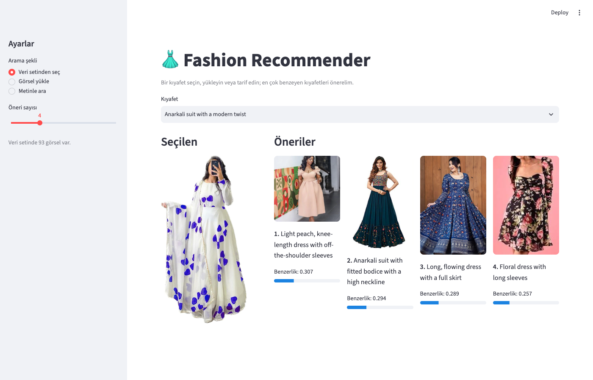
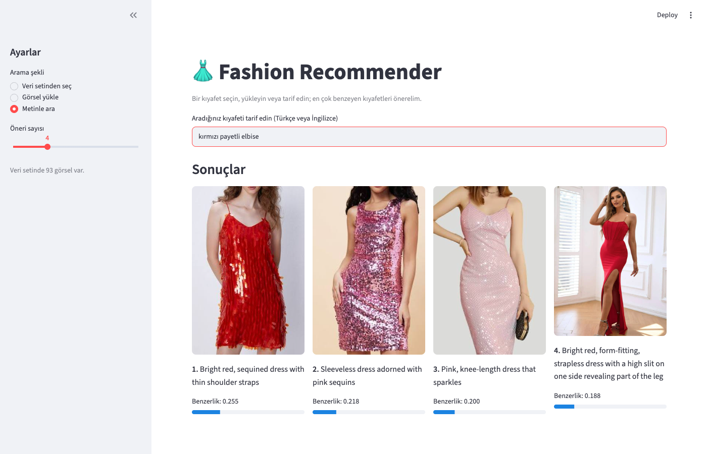

# 👗 Fashion Recommender

Görsel benzerliğine dayalı kıyafet öneri sistemi. Bir kıyafet görseli verildiğinde, veri setindeki görsel olarak en çok benzeyen kıyafetleri önerir. Kıyafeti Türkçe veya İngilizce tarif ederek de arama yapılabilir (ör. *kırmızı payetli elbise*).

Üç şekilde kullanılabilir:

- **Python paketi** — `fashion_rec`
- **Komut satırı (CLI)** — `python -m fashion_rec ...`
- **Web arayüzü** — Streamlit





## Nasıl çalışır

1. `data/women fashion/` altındaki görseller listelenir (`.jpg`, `.jpeg`, `.png`, `.webp`).
2. ImageNet üzerinde önceden eğitilmiş **VGG16** ile her görselden bir özellik vektörü (25.088 boyut) çıkarılır ve L2 ile normalize edilir.
3. Vektörler `features.npz` dosyasına önbelleklenir. Görsel listesi değişince otomatik olarak yeniden hesaplanır.
4. Girdi görselinin vektörü tüm vektörlerle çarpılır (normalize vektörlerde nokta çarpımı = cosine benzerliği) ve en yüksek skorlu N görsel döner. Girdi görseli veri setindeyse sonuçlardan çıkarılır.

Veri setindeki bir görsel için vektör önbellekten alınır, model hiç yüklenmez. Model yalnızca veri setinde olmayan bir görsel geldiğinde açılır.

**Metinden arama** için çok dilli bir [CLIP](https://github.com/mlfoundations/open_clip) modeli (`xlm-roberta-base-ViT-B-32`, LAION-5B) kullanılır: görseller ve arama metni aynı vektör uzayına kodlanır, en yüksek cosine benzerliğine sahip görseller döner. Metin Türkçe veya İngilizce (ve diğer pek çok dilde) yazılabilir. CLIP vektörleri ayrı bir önbellekte (`clip_features.npz`) tutulur; önbellek modeli de kaydeder, model değişince otomatik yeniden hesaplanır.

Görselden görsele öneride VGG16 ile CLIP karşılaştırıldı ve belirgin bir kazanan çıkmadı. Metinden aramada çok dilli model, 20 Türkçe sorgunun 19'unda doğru kıyafeti ilk 3'e getirdi (OpenAI CLIP: 3/20). Ayrıntılar `PROJE.md` ve `notebooks/` altında.

## Kurulum

Python 3.11 gerekir. Örnek (conda):

```bash
conda create -n fashion-rec python=3.11
conda activate fashion-rec
pip install -r requirements.txt
```

İlk çalıştırmada VGG16 ağırlıkları (~60 MB) Keras tarafından, CLIP ağırlıkları (~1,5 GB) Hugging Face'ten otomatik indirilir. TensorFlow ve PyTorch birlikte kurulduğu için ortam ~3 GB yer kaplar.

## Kullanım

Tüm komutlar proje klasöründen çalıştırılır.

### Komut satırı

Özellikleri çıkarıp önbelleğe almak için (93 görsel için birkaç saniye sürer):

```bash
python -m fashion_rec index           # önbellek varsa onu kullanır
python -m fashion_rec index --force   # önbelleği yok sayıp yeniden hesaplar
python -m fashion_rec index --text    # metin araması (CLIP) indeksini de oluşturur
```

Bir görsele benzeyen kıyafetleri önermek için:

```bash
python -m fashion_rec recommend "data/women fashion/black floral saree.jpg" -n 5
```

```
Girdi: black floral saree.jpg

 1. 0.455  Anarkali suit with fitted bodice with a high neckline.jpg
 2. 0.412  long, intricately designed dress with full sleeves.jpg
 3. 0.393  anarkali suit with intricate silver embellishments on the neckline, sleeves.jpg
 4. 0.379  anarkali suit with lavender in color with intricate white patterns throughout the fabric.jpg
 5. 0.376  black jumpsuit with a diagonal stripe of glittering material running across the body.jpg
```

Girdi görseli veri setinde olmak zorunda değil, herhangi bir görsel yolu verilebilir. Önbellek yoksa `recommend` onu önce kendisi oluşturur.

Metinle aramak için:

```bash
python -m fashion_rec search "kırmızı payetli elbise" -n 3
```

```
Sorgu: kırmızı payetli elbise

 1. 0.255  bright red, sequined dress with thin shoulder straps.jpg
 2. 0.218  sleeveless dress adorned with pink sequins.jpg
 3. 0.200  pink, knee-length dress that sparkles.jpg
```

CLIP skorları doğası gereği düşük ve birbirine yakındır (≈0,15–0,3); önemli olan sıralamadır. Her `search` çağrısı modeli yeniden yüklediği için ~10 sn sürer; arayüzde model bir kez yüklenir ve aramalar anında döner.

### Web arayüzü

```bash
streamlit run app.py
```

Kenar çubuğundan arama şeklini (veri setinden seç / görsel yükle / metinle ara) ve öneri sayısını (1–12) seçin. Öneriler benzerlik skorlarıyla birlikte ızgara halinde gösterilir.

### Python'dan

```python
from fashion_rec.features import build_index
from fashion_rec.recommend import recommend

paths, features = build_index()
for path, score in recommend("benim_elbisem.jpg", paths, features, top_n=5):
    print(f"{score:.3f}  {path.name}")

from fashion_rec.text_search import build_text_index, load_clip_model, search

clip = load_clip_model()
paths, features = build_text_index(model=clip)
results = search("black lace dress", paths, features, top_n=5, model=clip)
```

## Testler

```bash
python -m pytest
```

Testler sahte, hafif modeller (VGG16 ve CLIP yerine) ve düz renkli test görselleri kullanır. TensorFlow ve PyTorch yüklenmeden saniyenin altında çalışırlar.

## Proje yapısı

```
fashion-recommender/
├── fashion_rec/          # Python paketi
│   ├── __main__.py       # CLI giriş noktası
│   ├── config.py         # yollar, görsel boyutu, batch boyutu
│   ├── data.py           # görsel listeleme
│   ├── features.py       # model yükleme, özellik çıkarma, önbellek
│   ├── recommend.py      # benzerlik hesabı + öneri
│   └── text_search.py    # çok dilli CLIP ile metinden arama
├── app.py                # Streamlit arayüzü
├── data/women fashion/   # 93 kadın kıyafeti görseli
├── notebooks/            # model / havuzlama karşılaştırmaları
├── docs/                 # README görselleri
├── tests/                # pytest testleri
├── requirements.txt
└── PROJE.md              # yol haritası ve çalışma notları
```

Ayarlar (veri klasörü, önbellek yolları, görsel boyutu, batch boyutu, CLIP modeli) `fashion_rec/config.py` içindedir.

## Veri seti

93 kadın kıyafeti görseli. Dosya adları kıyafetin açıklamasıdır (ör. `black floral saree.jpg`) ve arayüzde etiket olarak kullanılır.
